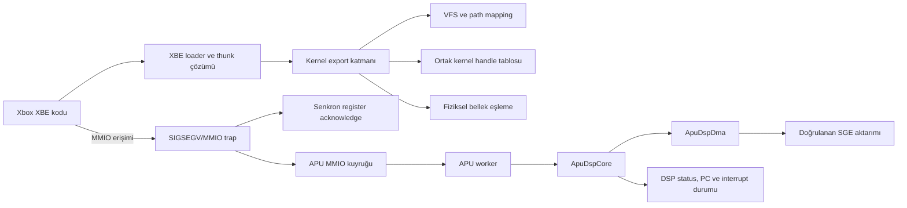

# XXCL Yeni Oturum Devir Belgesi

Son güncelleme: 13 Ekim 2026
Çalışma dizini: `/home/hakan/Desktop/xxcl-bin`

## Yeni sohbete verilecek kısa prompt

Aşağıdaki metni yeni Codex sohbetine gönder:

```text
/home/hakan/Desktop/xxcl-bin projesinde çalış. Önce SESSION_HANDOFF.md dosyasının
tamamını, ardından STATUS.md, PROJECT_ARCHITECTURE.md ve GEMINI_ROOT.md dosyalarını
oku. Git durumunu ve HEAD'i belgede yazan değerlerle doğrula; mevcut değişiklikleri
ve sahipsiz debug dosyalarını koru. Sega GT yalnızca genel Xbox uyumluluğunu ölçen
entegrasyon testidir; oyuna özel hack ekleme.

İlk iş olarak commit edilmemiş pencere-kapanış DSP özetini incele, derle, 7 sözleşme
testini çalıştır ve pencereyi elle kapatarak özet satırlarının basıldığını ve
`terminate called without an active exception` görülmediğini doğrula. Ardından en
güncel gerçek engel olan GP DSP `PC=0x064`, `P=0x0D104A` komutunu aynı izole HDD
kökünde yeniden üret. Komutu güvenilir DSP56300 komut belgelerinden çöz, önce genel
bir sözleşme testi ekle, sonra ApuDspCore içinde gerçek genel davranışı en küçük
değişiklikle uygula. Tüm testler geçince aynı Sega GT koşusunu yeniden yap ve yeni
PC/milestone'u kaydet. STATUS.md ile PROJECT_ARCHITECTURE.md dosyalarını kanıta göre
güncelle. Mantıklı ve doğrulanmış her checkpoint'i yalnız ilgili dosyaları stage
ederek commit et ve main'i pushla. Her koşuda geçici `--hdd-root` kullan; depodaki
hdd/ ağacını değiştirme.
```

## Projenin amacı ve değişmez ilkeler

XXCL, özgün Xbox XBE programlarını Linux üzerinde çalıştıran modüler bir uyumluluk
katmanıdır. HLE kernel çağrıları ile düşük seviyeli MMIO/donanım davranışlarını
birleştirir. Sega GT 2002 şu anki entegrasyon testidir; mimari hedef yalnız Sega GT'yi
geçirmek değil, Xbox davranışını başka oyunların da kullanabileceği şekilde
uygulamaktır.

- Oyun adına, title ID'ye veya tek bir gözlenen adrese bağlı bypass ekleme.
- Xbox kernel export imzalarını ve `__stdcall` çağrı düzenini sabit tut.
- VFS, dosya, handle, fiziksel bellek, MMIO, APU, DSP ve DMA sorumluluklarını kendi
  modüllerinde tut.
- Bir durum bitini yalnız oyunu ilerletmek için koşulsuz temizleme veya set etme;
  gerçek cihaz olayına bağla.
- Entegrasyon koşularında daima geçici `--hdd-root` kullan.
- Yeni davranışı önce oyun bağımsız bir sözleşme testiyle tanımla.
- Yalnız amaçlanan dosyaları stage et. Çalışma ağacındaki eski debug araçlarını ve
  kullanıcı dosyalarını koru.

## Basit dille şu an neredeyiz?

Başlangıçta oyun dosya sistemi, kernel çağrıları, ses donanımı ve fiziksel bellek
eşlemelerinde çok daha erken duruyordu. Bu katmanlar genel modüllere ayrıldı ve oyun
önceki çökme/döngü noktalarını geçti. Xbox ses işlemcisinin programı artık yükleniyor,
çalışıyor, frame sinyalini alıyor ve gözlenen DMA aktarımını tamamlıyor.

Şu anda ekran üretme aşamasında değiliz. Ses işlemcisinin firmware'i `PC=0x064`
adresinde, henüz desteklenmeyen `0x0D104A` komutuna gelince güvenli biçimde duruyor.
Bir sonraki küçük ama gerçek ilerleme, bu komutun Xbox'taki DSP56300 davranışını genel
olarak uygulayıp firmware'i bir sonraki komuta taşımaktır.

Son görülen
`[KERNEL] MmGetPhysicalAddress(...) -> Phys: ...` satırı engelin kendisi değildir.
Güncel engel APU trace içinde görülen DSP checkpoint'idir.

## Doğrulanmış Git ve çalışma durumu

- Dal: `main`
- Yerel HEAD: `a34da6f9c51b16f53bd489a6c95a9e92d158355b`
- `origin/main`: aynı commit
- Son push edilmiş checkpoint: `a34da6f feat: support DSP compare X0 with accumulator A`
- Push edilmiş son ana ilerlemeler:

  | Commit | Kazanım |
  | --- | --- |
  | `9ab5e77` | GP DSP program belleğini SGE scratch alanından yükleme |
  | `a901022` | GP DSP firmware'ini APU worker üzerinde yürütme |
  | `6c3f0bf` | DSP DMA register modeli ve frame interrupt'ları |
  | `22dcfea` | Kısa göreli `BSR` |
  | `685bf9a` | MOVEP A/B accumulator alias düzeltmesi |
  | `f71455a` | GP DSP DMA descriptor yürütme ve format-6 scratch aktarımı |
  | `a34da6f` | PM2 `CMP X0,A` ve bayrakları |

### Henüz commit edilmemiş kaynak değişikliği

Şu üç kaynak dosyasında pencere kapanırken DSP özeti basan küçük bir değişiklik var:

- `xbe-inspect/src/kernel/apu.hpp`: `ApuDspDebugStats` ve snapshot API'si.
- `xbe-inspect/src/kernel/apu.cpp`: toplam yürütülen DSP komutu sayacı ve PC/program
  word snapshot'ı.
- `xbe-inspect/src/video/window.cpp`: `SDL_QUIT` geldiğinde APU worker'ını join edip
  DSP PC, `P[PC..PC+2]` ve sayaç değerini yazdırma.

Bu değişiklikle kalıcı wrapper hedefi başarıyla derlendi. Ancak pencereyi elle kapatma
akışı henüz doğrulanmadı ve bu değişiklikten sonra 7 testin tamamı yeniden
çalıştırılmadı. Önceki commitli kaynakta 7/7 test geçiyordu. Mevcut logda kapanıştan
sonra görülen `terminate called without an active exception`, bu değişikliğin çözmek
istediği join edilmemiş worker sonucudur.

Not: Yazdırılan etiket şu an `DSP commands=...`, fakat sayaç gerçekte yürütülen DSP
instruction sayısıdır. Committen önce etiketi `DSP instructions=...` yapmak daha
doğru olur.

Çalışma ağacında ayrıca takip edilen `xbe-inspect/xbe-inspect` ikili dosyası değişmiş
ve çok sayıda takip edilmeyen eski debug scripti/logu vardır. Bunlar bu görev için
stage edilmemeli, silinmemeli veya sıfırlanmamalıdır. Yeni sohbet önce `git status
--short --branch` ve hedefli `git diff -- <dosyalar>` ile kapsamı yeniden
doğrulamalıdır.

## Güncel çalışma kanıtı

- Sega GT XBE:
  `/home/hakan/Desktop/Sega GT 2002 (Europe) (En,Ja,Fr,De,Es,It)/default.xbe`
- Son kullanılan izole runtime kökü: `/tmp/xxcl-sega-alias2.GFlyJg`
- Son trace: `/tmp/xxcl-sega-cmp-run.log`
- Son tekrar eden checkpoint:

  ```text
  [APU DSP GP] worker checkpoint PC=0x064 P=0D104A/000039/0A0480 executed=0
  ```

- Koşu 8 saniyelik tanılama timeout'una ulaştı. Bu checkpoint'te doğrulanmış bir
  SIGSEGV yoktur.
- Önceki engeller `PC=0x121`, `PC=0x060` ve `PC=0x063` geçildi.
- Depodaki `hdd/` dosya ağacının doğrulanmış birleşik SHA-256 değeri:
  `12bdcc58323e06ce7c8538399c2dcb947a8f22e53fda842b986d20e8d1d7b8f0`
- `xxcl` komutu `/home/hakan/.local/bin/xxcl` üzerinden depo kökündeki `xxcl`
  wrapper'ına, o da `xbe-inspect/build/xbe-inspect` ikilisine gider.

## Teknik mimari



### Başlatma ve kernel ABI

- `src/loader.cpp` XBE bölümlerini eşler, kernel thunk'larını çözer, Xbox KPCR'ını
  hazırlar ve entry point'i çağırır.
- `src/kernel/exports.cpp` ordinal ile uygulama arasındaki kayıt katmanıdır.
- Export imzaları dış ABI'dir. İç uygulama modülerleşebilir; parametre düzeni ve
  calling convention değişmemelidir.

### VFS, dosya ve cihaz sınırları

- `vfs.cpp/.hpp`: Xbox drive mapping, symbolic link çözümü, path normalizasyonu,
  traversal reddi ve yapılandırılabilir host root.
- `handles.cpp/.hpp`: dosya ve thread nesneleri için ortak kimlik/ömür yönetimi.
- `io.cpp/.hpp`: `NtCreateFile`, open/read/write/close, offset ve desteklenen
  file/volume sorguları. FATX allocation unit değeri 16 KiB olarak sunulur.
- `device_io.cpp/.hpp`: cihaz protokolü davranışları. CD-ROM SCSI yanıtları burada
  kalır; genel dosya yoluna oyun özel koşullar girmez.

### Bellek ve MMIO

- `physical_memory.cpp/.hpp` host allocation ile Xbox fiziksel adresleri arasında
  çift yönlü ve kararlı eşleme sağlar.
- `mmio.cpp/.hpp` korunan donanım alanlarına erişimi yakalar. Sinyal bağlamında ağır
  iş yapmak yerine APU yazılarını kuyruğa bırakır; gerekli senkron komutları guest
  devam etmeden acknowledge eder.
- NV2A, APIC ve APU kendi register alanlarının sahipleridir. Bir alt sistem başka bir
  cihazın MMIO alanını rastgele değiştirmemelidir.

### APU, DSP ve DMA

- `apu.cpp/.hpp`: APU register varsayımları, MMIO kuyruğu, GP bootstrap ve worker
  zamanlaması. Worker yaklaşık her 667 mikrosaniyede bir frame başlatır ve frame
  başına en fazla 27.000 DSP komutu yürütür. Bu şu an bring-up zamanlamasıdır;
  cycle-accurate değildir.
- `apu_dsp.cpp/.hpp`: 24-bit program/data words, registerlar, accumulator parçaları,
  PC, return stack, loop/repeat, condition flags ve desteklenen DSP56300 komutları.
  `step()` ilk desteklenmeyen komutta durarak eksik davranışı görünür tutar.
- `apu_dsp_dma.cpp/.hpp`: DMA register eylemleri, descriptor zinciri, circular offset
  writeback ve EOL sahipliği. Gözlenen format 6, ortak SGE scratch aktarımını kullanır.
- `apu_sge_transfer`: tüm descriptor ve guest page aralığını kopyalamadan önce
  doğrular; geçersiz aralıkta kısmi aktarım yapmaz.
- GP bootstrap 0x800 adet little-endian 24-bit program word yükler.
- Şu ana kadar BSR, MOVEP, doğrudan X/Y MOVE, PM2 immediate/register biçimleri,
  `CMP X0,A`, frame interrupt ve gözlenen DMA yolu için sözleşme kapsamı vardır.

### Video ve kapanış

- `video/window.cpp` SDL penceresini ve event poll'u yönetir.
- Commit edilmemiş kapanış değişikliği, worker çalışırken process exit edilmesinden
  doğan `std::terminate` sorununu önlemek ve son DSP checkpoint'ini kullanıcıya
  göstermek içindir.

## Belge güven sırası ve bilinen eski notlar

Yeni bir görevde şu sırayı kullan:

1. Bu `SESSION_HANDOFF.md` dosyası.
2. `STATUS.md` ve `PROJECT_ARCHITECTURE.md`.
3. İlgili kaynak kod, testler, güncel Git diff ve aynı koşunun logu.
4. `README.md` ve `GEMINI_ROOT.md` içindeki tarihsel bilgiler.

`README.md` içindeki “DSOUND `0x0015F8DB` hâlâ çöküyor” maddesi güncel değildir; bu
engel MMIO acknowledgement ile geçildi. `GEMINI_ROOT.md` içindeki “Ordinal 255
öncelikli hedef” de eski bir checkpoint'tir. Bu dosyalardaki genel modülerlik,
cerrahi değişiklik ve oyun özel hack kullanmama kuralları geçerlidir.

## Tekrarlanabilir geliştirme döngüsü

Her uyumluluk ilerlemesinde aşağıdaki döngüyü uygula.

### 1. Çalışma ağacını koru ve başlangıcı kaydet

```bash
cd /home/hakan/Desktop/xxcl-bin
git status --short --branch
git rev-parse HEAD
git diff -- xbe-inspect/src/kernel/apu.cpp \
  xbe-inspect/src/kernel/apu.hpp \
  xbe-inspect/src/video/window.cpp
find hdd -type f -print0 | sort -z | xargs -0 sha256sum | sha256sum
```

Başlangıç kriteri: beklenmeyen bir dosyaya dokunmadan mevcut diff ve HDD hash'i
kayıt altına alınmış olmalı.

### 2. İzole debug build ve sözleşme testleri

```bash
cmake -S xbe-inspect -B /tmp/xxcl-debug-build -DCMAKE_BUILD_TYPE=Debug
cmake --build /tmp/xxcl-debug-build -j"$(nproc)"
ctest --test-dir /tmp/xxcl-debug-build --output-on-failure
```

Kriter: derleme başarılı ve 7/7 CTest hedefi geçmeli. Değişiklik wrapper üzerinden
kullanılacaksa kalıcı hedefi de güncelle:

```bash
cmake -S xbe-inspect -B xbe-inspect/build
cmake --build xbe-inspect/build -j"$(nproc)"
```

### 3. Aynı koşuyu izole HDD ile yeniden üret

```bash
GAME_XBE='/home/hakan/Desktop/Sega GT 2002 (Europe) (En,Ja,Fr,De,Es,It)/default.xbe'
RUN_ROOT="$(mktemp -d /tmp/xxcl-sega.XXXXXX)"
XXCL_TRACE_APU=1 timeout 8s ./xxcl "$GAME_XBE" --run \
  --hdd-root "$RUN_ROOT" 2>&1 | tee /tmp/xxcl-sega-first.log
XXCL_TRACE_APU=1 timeout 8s ./xxcl "$GAME_XBE" --run \
  --hdd-root "$RUN_ROOT" 2>&1 | tee /tmp/xxcl-sega-second.log
```

Boş root'taki ilk açılış `TDATA`/`UDATA` oluşturup firmware reboot isteyebilir; ikinci
açılış asıl checkpoint'i verir. `timeout` nedeniyle 124 çıkış kodu, log hedeflenen
checkpoint'e ulaştıysa tek başına hata sayılmaz.

Kriter: aynı run'ın PC, instruction, register/stack ve son kernel/APU çağrıları aynı
logdan çıkarılmalı. Farklı koşuların kanıtları birbirine karıştırılmamalı.

### 4. Eksik davranışın gerçek sözleşmesini çıkar

`0x0D104A` için özellikle:

- DSP56300 komut formatını güvenilir ISA belgesinden çöz.
- Ardındaki `0x000039` word'ünün extension/target/operand olup olmadığını doğrula;
  `0x0A0480` bir sonraki olası komuttur.
- Etkilenen PC artışı, stack, register, memory ve status bitlerini yazılı hale getir.
- Mevcut `ApuDspCore::step()` decode sırasındaki çakışmaları kontrol et.

Kriter: implementasyondan önce giriş, beklenen çıktı ve kaç program word tüketildiği
kesin olmalı.

### 5. Önce oyun bağımsız kırmızı test

Yeni komutu `xbe-inspect/tests/apu_dsp_contract_tests.cpp` içinde küçük bir firmware
dizisiyle kur. Normal durumun yanında komutun gerçekten etkilediği en az bir bayrak,
register, stack veya PC davranışını doğrula.

Kriter: test mevcut uygulamada doğru nedenle başarısız olmalı.

### 6. En küçük genel implementasyon

Decode ve yürütmeyi `ApuDspCore` içinde gerçek opcode maskesine ve ISA semantiğine
göre ekle. Sega GT adresi, oyun adı veya mevcut operand değerleriyle koşullanan yol
oluşturma.

Kriter: yeni sözleşme geçmeli ve önceden geçen sözleşmeler aynı kalmalı.

### 7. Tam doğrulama ve entegrasyon karşılaştırması

Debug build, 7 CTest ve aynı izole runtime köküyle ikinci koşuyu tekrar çalıştır.
Ardından depo HDD hash'ini yeniden hesapla.

Kriterler:

- 7/7 test geçer.
- DSP `PC=0x064` noktasını geçer.
- Yeni ilk engel veya anlamlı milestone, instruction ve yakın program word'leriyle
  kaydedilir.
- Depodaki `hdd/` hash'i hâlâ
  `12bdcc58323e06ce7c8538399c2dcb947a8f22e53fda842b986d20e8d1d7b8f0` olur.

### 8. Notları ve Git checkpoint'ini kapat

Kanıt kesinleşince `STATUS.md` ile `PROJECT_ARCHITECTURE.md` dosyalarını güncelle.
Yalnız ilgili kaynak, test ve dokümanları stage et. Tracked binary, debug logları ve
eski scriptleri checkpoint'e katma. Commit/push öncesi hedefli diff ve test sonucunu
bir kez daha gözden geçir.

Kriter: `main` üzerindeki commit tek bir genel uyumluluk kazanımını anlatmalı;
`origin/main` push sonrası aynı commit'e işaret etmeli.

## İlk sıradaki somut işler

1. Pencere-kapanış DSP özetindeki etiketi `instructions` olarak düzelt, build/test
   yap ve pencereyi elle kapatarak worker'ın temiz kapandığını doğrula.
2. Bu küçük tanılama değişikliğini ayrı, dar kapsamlı bir commit olarak kaydet.
3. Aynı izole Sega GT ikinci açılışında `PC=0x064 / 0x0D104A` checkpoint'ini yeniden
   üret.
4. `0x0D104A` komutunu güvenilir DSP56300 dokümanıyla çöz ve kırmızı sözleşme testini
   ekle.
5. Genel implementasyonu yap, 7 testi ve entegrasyon koşusunu tekrar çalıştır.
6. Yeni checkpoint'i `STATUS.md` ve `PROJECT_ARCHITECTURE.md` içine yaz; kaynak,
   test ve dokümanları commit edip pushla.

Bir sonraki mantıklı durma noktası: kapanış özeti doğrulanmış ve commitlenmiş,
`0x0D104A` genel olarak desteklenmiş, 7/7 test geçmiş, Sega GT eski PC'yi geçmiş ve
yeni ilk engel aynı koşunun loguyla belgelenmiş olmalıdır.
